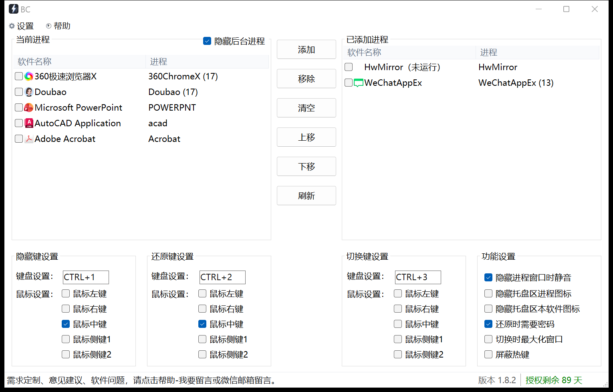

# BossComing 老板键 · Boss key for Windows

一个热键藏起当前在用的全部窗口，另一个热键原样还原。单文件绿色版，免安装、无需 .NET 运行库、不要管理员权限。

One hotkey hides every window you are working in; another brings them all back exactly where they were. Single portable exe: no installer, no runtime, no admin rights.

## 下载 / Download

**直链 / Direct link：**

https://gitee.com/Rodersoft/BossComing/releases/download/latest/BossComing.exe

**GitHub 备用 / GitHub mirror：**

https://github.com/Rodersoft/BossComing/releases/latest/download/BossComing.exe

**官网 / Official page：** https://bosscoming.netlify.app/

当前版本 / Current version：**1.8.2**　·　Windows 10 / 11，64 位。

## 功能 / Features

- **一键隐藏**：按隐藏热键，列表里所有程序的窗口一次消失，最小化的、缩在托盘的也一样处理。
- **一键还原**：按还原热键，全部窗口回到原来的位置和状态，跟藏起来之前一模一样。
- **一键切换**：按切换热键，在几组窗口之间轮换，按一次热键切一个窗口。
- **热键随便设**：三个热键都能自己定，键盘鼠标都行——左键、右键、中键、两个侧键，组合不限。
- **图标名字随你换**：软件图标和名称都能换成自己的图片和文字，摆在桌面上不扎眼。
- **托盘不留痕**：可选同步隐藏被隐藏程序的托盘图标，本软件自己的托盘图标也能藏。
- **顺手静音**：隐藏期间把被隐藏程序的声音一并静音。
- **可选密码**：还原前要输密码，别人调不出你的窗口。
- **进程列表好认**：每个程序显示图标、软件名和进程名；右上角勾上「隐藏后台进程」，只留真正有界面的软件，纯托盘后台不占位置，打开着的程序一个不漏。
- **切换后可选最大化**：切过去的窗口自动铺满，接上就能接着用。
- **中英文界面**，随时切换。
- **绿色免安装**：单个 exe，免安装、无需运行库、不要管理员权限，U 盘里也能跑。

- **Hide:** press the hide hotkey and every window of the listed programs disappears at once — minimized and tray-resident ones included.
- **Restore:** press the restore hotkey and all of them come back in their original position and state, exactly as you left them.
- **Switch:** press the switch hotkey to rotate through window groups, one window per press.
- **Your own hotkeys:** all three can be set freely — keyboard or mouse (left, right, middle, side 1, side 2), any combination.
- **Your own icon and name:** swap the app icon and title for your own image and text, so it blends into the desktop.
- **Tray clean:** optionally hide the tray icons of the hidden programs, and BossComing's own tray icon too.
- **Silent:** mute the hidden programs while they are hidden.
- **Password:** optionally require a password before restoring.
- **Clear list:** icon, app name and process name for every running program; the "Hide background apps" checkbox keeps only programs with a real interface, and open programs are never dropped.
- **Optional maximize:** windows can be maximized automatically after a switch, ready to use.
- **Chinese / English UI**, switchable at runtime.
- **Portable:** one exe, no installer, no runtime, no admin rights — runs from a USB stick.

## 授权 / License

免费下载使用，更多功能可选授权：**9.9 元/年（促销）** 或 **39 元永久**。

Closed-source. Free to download and use; optional license at ¥9.9/year or ¥39 lifetime. Reverse engineering, cracking the license, repackaging or reselling the app is not allowed.

## 反馈 / Feedback

软件内「帮助 → 我要留言」，或邮件 **rodersoft@163.com**。
Use **Help → 我要留言** inside the app, or email **rodersoft@163.com**.
